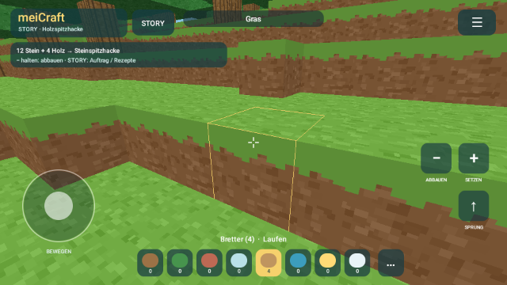

# meiCraft

Eigenständiges Klötzchenspiel für Android ab 8.0, mit nativer 3D-Welt, eigener Grafik und lokal gespeicherten Welten. Offline ohne Anmeldung, Werbung oder Käufe. Optional gemeinsam online bauen: Firebase speichert dafür eine anonyme Geräte-ID, Weltänderungen und Mitspielerpositionen.

**[APK herunterladen](https://github.com/pehab/MeiCraft/releases/latest)** · Version 0.8.0

## Gemeinsam bauen · 0.8.0

**Gemeinsam bauen** öffnet Online-Bauwelten mit 192 × 192 oder 288 × 288 Blöcken.
Die zusammenhängende Welt lädt beim Weiterlaufen die Umgebung nach. Ihr startet zu
Fuß, sammelt eigene Rohstoffe und schaltet Werkzeuge und Rezepte an der Werkbank frei.
Mitspieler erscheinen mit Haut- und Kleidungsfarben; eine kleine Weltkarte zeigt ihre
Positionen. Gegner, Tageszeit und Flüssigkeiten bleiben online statisch.

**Beim Update von 0.7.0 die neuen Firestore-Regeln veröffentlichen und zuerst den
Besitzer mit 0.8.0 verbinden lassen. Danach alle Mitspieler aktualisieren.** Bestehende
Bauten und Einladungen bleiben erhalten. [Einrichtung und Update](docs/ONLINE.md).

## Hauptmenü und Weltenverwaltung · 0.6.0

Beim Start erscheint das Hauptmenü. **Weiterbauen** öffnet die zuletzt gewählte Welt; **Welten verwalten** bietet Spielen, Umbenennen, QR-Teilen und Löschen für jede Welt. Gelöscht wird erst nach ausdrücklicher Bestätigung. Auch die gerade geöffnete und die letzte Welt können entfernt werden; gelöschte Welten tauchen weder durch Autospeichern noch nach einem Neustart wieder auf. Nach dem Löschen aller Welten lassen sich neue Welten anlegen oder per QR empfangen.

Im Hauptmenü liegen außerdem neue Welten, QR-Empfang, Update-Suche, Steuerung und **Über meiCraft** mit Version und Update-Einstellungen. Das Pausenmenü im Spiel enthält nur noch die direkten Spielaktionen und den Weg zum Hauptmenü. Im Hauptmenü steht die Spielzeit still.

## Versteckte Reaktionen in der Welt · 0.6.0

Lava kann mehr als leuchten: Manche Materialien verändern sich, wenn man sie längere Zeit direkt über einer Quelle platziert. Glühen, Funken und die Anzeige beim Anvisieren zeigen eine begonnene Reaktion. In neuen Storywelten kann eine verfallene Glutstätte einen Hinweis liefern. Diese Möglichkeiten stehen nicht in der Rezeptliste der Werkbank.

Die Reaktionen funktionieren auch in bestehenden Welten, deren Landschaft beim Laden unverändert bleibt. Neu gespeicherte Welten verwenden Format 5 und erhalten laufende Reaktionen über Laden, App-Neustart und QR-Übertragung. Alte Formate 1–4 bleiben lesbar. Zum Empfangen von Welten aus 0.6.0 muss das andere Gerät ebenfalls aktualisiert sein.

## Kreativ und Story

Kreativwelten behalten unbegrenzte Materialien, sofortiges Abbauen und optionales Fliegen. Vorhandene Spielstände aus 0.1.0 und 0.2.0 bleiben erhalten.

Der **Storymodus** speichert in einer eigenen Datei. Über **STORY** oben im Spiel wechselst du den Modus beziehungsweise öffnest Aufträge und Werkbank. Du läufst, springst und sammelst Material. Gesetzte Blöcke werden vom Inventar abgezogen. Zum Abbauen hältst du **−** gedrückt; härtere Blöcke brauchen bessere Werkzeuge.

1. Gras/Erde mit der Hand sammeln; Miko tauscht 8 Erde gegen ein Holzwerkzeug.
2. Holz und Erde für Werkbank und Holzspitzhacke sammeln. Damit wird Stein abbaubar.
3. Eine Steinspitzhacke herstellen und Eisenerz erschließen.
4. Einen Ofen bauen und Erz mit Holz als Brennstoff schmelzen.
5. Eisenwerkzeug herstellen, Gebäude mit Fenstern bauen und tief im Gestein Leuchtstein finden.

Die Werkbank stellt Bretter, Ziegel und Grasblöcke her. Im Ofen entstehen Glas und Eisenbarren; später lassen sich Eisenblöcke bauen. Die sieben Einführungskapitel gehen anschließend in freies Bauen mit begrenzten Ressourcen über. Hunger, Rüstung und Explosionsgegner sind noch nicht enthalten. Gemeinsame Online-Welten gibt es separat im Kreativmodus. Die Welt ist 96 × 96 × 48 Blöcke groß.

## Nacht, Gegner und Lava · 0.3.0

Im Storymodus dauert ein Zyklus zwölf Minuten. Nach acht Minuten erscheinen draußen bis zu sechs **Nachtschatten**; beim Morgengrauen verschwinden sie. Der Himmel und die Landschaft werden dunkel, Leuchtstein und Lava leuchten. Mauern blockieren die Gegner, Gräben halten sie auf. Nahe Leuchtsteinen und Lava entstehen keine neuen Gegner. Zeit und Gegner stehen in Menüs und im Hintergrund still.

Visiere einen Gegner an und halte **−** zum Nahkampf. Ein Eisenschwert kostet **2 Eisenbarren + 1 Holz** an der Werkbank. Die Anzeige zeigt Tagesphase, verbleibende Zeit bis zum Wechsel und zehn Lebenspunkte. Leben regeneriert nach einer Pause ohne Schaden. Bei einer Niederlage kehrst du zu einem sicheren Platz nahe dem ursprünglichen Start zurück; Bauwerke, Werkzeuge und Vorräte bleiben erhalten. Unter **STORY → Nachtgegner** kannst du Gegner ausschalten.

**Lavagraben:** Grabe einen Graben, stelle einen Eiseneimer aus **3 Eisenbarren** her und suche in neuen Storywelten nach Lava in Steinbecken. Visiere die Lava an und tippe **−**, um den Eimer zu füllen. Wähle **Lava** in der Materialliste und gieße sie mit **+** in den Graben; der leere Eimer wird zurückgegeben. Auch Gegner nehmen durch Lava Schaden. Lava ist für dich ebenfalls gefährlich. Ausgegossene Lava fließt langsam nach unten und begrenzt zur Seite.

Bestehende Welten werden vollständig geladen, ohne neue Lavaquellen in Bauwerke zu setzen. Dort lässt sich ein Lavaeimer im Ofen aus **1 leerem Eimer + 1 Leuchtstein + 4 Stein + 2 Holz** herstellen. Das ist ein eigenes meiCraft-Rezept. Im Kreativmodus ist Lava unbegrenzt verfügbar; dort gibt es keine Gegner und keinen Lebensverlust. Uhrzeit, Gegner, Lebenspunkte und Ausrüstung werden pro Welt gespeichert; alte Speicherformate 1, 2 und 3 bleiben lesbar.

## Wasser, Lavahöhlen und Gras · 0.4.0

Neue Storywelten enthalten bis zu sechs Lavahöhlen tief im Gestein, 3–5 Blöcke über dem Weltboden. Die Mitte jedes Sees ist eine **nachfüllbare Lavaquelle**, beim Anvisieren entsprechend beschriftet. Mit einem leeren Eiseneimer und **−** erhältst du beliebig oft Lava aus dieser Quelle. Die anderen Lavablöcke sind endlich. Natürliche Wasserblöcke lassen sich ebenso mit dem Eiseneimer schöpfen und füllen sich nach.

**Alte Storywelt:** Wähle einmal **STORY → Lavahöhlen in dieser Welt ergänzen**. Die Ergänzung prüft vollständige Gesteinsvolumen samt Rand gegen die ursprüngliche Welt und überspringt bearbeitete Bereiche. Beim Laden wird kein Block verändert. Ist der Untergrund überall bearbeitet, werden keine Höhlen ergänzt; das bisherige Ofenrezept bleibt verfügbar.

Wähle Wasser oder Lava im Baumaterial und gieße mit **+** aus. Der leere Eimer kommt zurück. Ausgegossene Quellen fließen schrittweise nach unten und auf tragfähigem Untergrund zur Seite: Wasser bis zu vier Blöcke, Lava langsamer bis zu zwei Blöcke weit. Gefälle verlängern die seitliche Reichweite nicht. Die Quelle lässt sich wieder aufnehmen, danach trocknen abhängige Ströme aus. Strömende Blöcke lassen sich nicht in neue Eimer verwandeln. Die Zahl dynamischer Flüssigkeitsblöcke ist pro Welt begrenzt. Bestehende natürliche Seen bleiben ruhend. Unter **STORY → Flüssigkeiten fließen** lässt sich das Fließen pausieren.

Bei Flächenkontakt mit Wasser wird der berührte Lavablock zu Stein; Wasser bleibt erhalten. Das kann auch eine natürliche Lavaquelle endgültig abkühlen. Sand direkt neben Lava wird nach bis zu drei Sekunden zu Glas; die Lava bleibt als Wärmequelle bestehen. Freiliegende Erde unter offenem Himmel wird neben Gras langsam grün, auch bei einer Höhenstufe Unterschied. **4 Erde + 1 Laub → 4 Grasblöcke** bleibt als sofortiges Werkbankrezept erhalten.

Speicherformat 4 erhält Quellen, Ströme, Höhlenergänzung und Fließ-Einstellung getrennt pro Welt. Menüs und Hintergrund pausieren die gesamte Simulation. Feuer und Brandausbreitung folgen erst in einer späteren Ausbaustufe.



## Welten per Kamera teilen · 0.5.0

Komplett offline, auch im Flugmodus: Auf dem sendenden Gerät **☰ → Welt per QR teilen**, auf dem anderen **☰ → Welt per QR empfangen** wählen und die Kamera auf den gesamten weißen Codebereich richten. Die Kameravorschau richtet sich in beiden Querformaten automatisch aus und zeigt das vollständige Bild ohne Verzerrung. Den ganzen weißen Codebereich mittig ins Bild nehmen; zum Nachfokussieren auf die Vorschau tippen. Nur der Empfänger braucht die Kameraberechtigung. Die Kamera läuft ausschließlich im sichtbaren Empfangsfenster; Bilder werden auf dem Gerät verarbeitet und nicht gespeichert oder übertragen.

Die Welt wird als wechselnde QR-Bilder angezeigt. Die Folge wiederholt sich automatisch, bis der Empfänger alle unterschiedlichen Bilder gesammelt hat. Reihenfolge und doppelt gescannte Bilder sind egal; der Fortschritt bleibt erhalten, wenn ein Bild verpasst wird. Bei Schwierigkeiten am Sender **Langsamer** wählen oder **Pause** und die Pfeile nutzen. Eine typische neue Storywelt ergibt ungefähr 50 Bilder; die genaue Zahl hängt vom Spielstand ab.

Nach vollständiger Prüfung zeigt der Empfänger Weltname und Modus. **Als neue Welt importieren** speichert eine Kopie mit eigener ID und öffnet sie. Vorhandene Welten werden nicht überschrieben; gleiche Namen bekommen einen Zähler. Bauten, Vorräte, Ausrüstung, Quellen, Ströme und Storyfortschritt werden übernommen. Beide Geräte bauen danach unabhängig weiter. Für gleichzeitiges gemeinsames Bauen gibt es den separaten Menüpunkt **Gemeinsam bauen**.

Die QR-Folge enthält den vollständigen lokalen Spielstand, keinen Download-Link. Es werden weder WLAN, Bluetooth noch Internet benötigt. Pro Fragment wird CRC32, für die vollständige Übertragung SHA-256 und anschließend das Weltformat geprüft. Größenlimits gelten vor dem Zusammensetzen und Importieren. Fortschritt kann über **Empfang zurücksetzen** verworfen werden; beim Schließen des Empfangs oder nach einem vollständigen Prozessneustart wird eine unvollständige Übertragung nicht gespeichert.

## Steuerung

**Die ursprüngliche Steuerung bleibt:** links am virtuellen Joystick bewegen, rechts wischen zum Umsehen. Mit **+** neben dem anvisierten Block bauen. In der Kreativwelt baut **−** sofort ab; im Storymodus hältst du **−** gedrückt. **↑** springt oder schwimmt aufwärts. In der Kreativwelt können **↑ / ↓** zum Fliegen genutzt werden. Gesammelte Blöcke helfen beim Bau von Stufen aus Gruben.

Das Spiel läuft fest im Querformat, auch bei eingeschalteter Hochformat-Drehsperre. Beide horizontalen Haltungen werden unterstützt. Die App ist als Spiel gekennzeichnet, damit die von Android dokumentierte Spiel-Ausnahme für feste Ausrichtungen auch auf großen Displays greift.

Unter **☰ → Neue Welt …** legst du eine zusätzliche Welt mit eigenem Namen, optionalem Seed und Modus (Kreativ oder Story) an. **☰ → Welten laden** zeigt alle gespeicherten Welten; Antippen lädt die gewählte Welt. Die offene Welt wird zuerst gespeichert. **☰ → Welt umbenennen** ändert ihren Namen. Beim App-Start wird die zuletzt gewählte Welt automatisch geladen. Über **Weltmodus wechseln** kehrst du zur zuletzt gespielten Welt des jeweiligen Modus zurück.

## Speicher und Updates

Automatisches Speichern alle 30 Sekunden und beim Wechsel in den Hintergrund; zusätzlich manuell im Menü. Jede Welt hat eine eigene atomar geschriebene GZIP-Datei. Neue Welten liegen unter `worlds/<UUID>.mcworld`; ihre Namen und Modi werden unabhängig davon in atomaren `.meta`-Dateien gespeichert. Die bisherigen Dateien `world.mcworld` und `story.mcworld` erscheinen als **Meine Kreativwelt** und **Meine Storywelt** und bleiben an ihrem bisherigen Ort. Ein fehlgeschlagener Speicher- oder Ladevorgang bricht den Weltwechsel ab. Weltdateien werden niemals aus Anzeigenamen abgeleitet. Version-1-Spielstände aus 0.1.0 bleiben kompatibel; unlesbare Start-Spielstände werden vor einer Neuerstellung als Sicherung behalten.

Updates: täglich automatisch beim Öffnen, abschaltbar, zusätzlich unter **☰ → Updates**. Downloads brauchen eine Bestätigung. Die App prüft SHA-256, Größe, Paketname, Version und Signatur vor der Android-Installation. Ein Update mit gleichem Signierschlüssel erhält beide Welten; eine Deinstallation entfernt den lokalen Fortschritt.

Die Release-Pipeline erzeugt Prüfsumme und Update-Manifest aus der geprüften APK. Fehlt das private Signier-Secret in CI, kann eine lokal mit dem ursprünglichen Schlüssel signierte APK unter `dist/` verwendet werden. Dafür müssen sämtliche APK-Inhalte (Code, Manifest, Ressourcen und Assets; ausgenommen Signaturdateien) bytegenau mit dem frischen CI-Build übereinstimmen. Veraltete Pakete oder abweichende Signaturen verhindern die Veröffentlichung. Weitere Gegnertypen und Rüstung sind in der [Roadmap](docs/ROADMAP.md) vorgemerkt.

## Bauen und prüfen

JDK 17, Android SDK Platform 37.0 und Build Tools 36.0.0. Für den QR-Codec wird ZXing Core 3.5.4 verwendet; der direkte Build lädt die feste Version von Maven Central und prüft ihren SHA-256-Wert. Die App benötigt diese Verbindung nicht zum Teilen oder Spielen. [Fremdkomponenten](docs/THIRD-PARTY.md).

```sh
export ANDROID_SDK_ROOT=/pfad/zum/android-sdk
./test.sh
./build-local.sh
bash scripts/build-upgrade-fixture.sh
./test-android-build.sh
```

Die APK liegt unter `build/meiCraft-0.6.0.apk`. Der direkte SDK-Build benötigt keine Spielbibliotheken. `.signing/` enthält den privaten, lokal wiederverwendeten Schlüssel und ist aus Git ausgeschlossen. Updates veröffentlichter APKs brauchen den ursprünglichen Projektschlüssel. Das private Secret `MEICRAFT_SIGNING_JSON` hat die Felder `keystore` (Base64-PKCS12), `password` und `alias` (`meicraft`); `scripts/restore-signing.py` stellt daraus den lokalen Schlüssel wieder her. CI-Testschlüssel werden nie veröffentlicht.

Alternativ Android Studio oder `./gradlew --warning-mode=fail assembleDebug lintDebug`. Versionen stehen in `version.properties`. Compiler-, Lint- und Gradle-Warnungen führen zu Fehlern. Der Gradle-Prüfpfad verwendet AGP 9.5.0-rc01 mit Kotlin-Build-Komponente 2.4.21, um deren dokumentierte Configuration.setVisible-Probleme mit Gradle 9.8.2 zu beheben. Die veröffentlichte APK entsteht direkt mit den stabilen SDK-Werkzeugen.

Auf einem Emulator ohne wertvollen Spielstand:

```sh
bash scripts/smoke-android.sh
```

CI prüft Android 11 und Android 17: tatsächliche Aktualisierung der bisherigen 0.2.0-APK (für CI neu signiert), Spielstanderhalt, ursprüngliche Wischsteuerung, Blick nach unten, Touch-Abbruch, festes Querformat und beide horizontalen Haltungen, System-Zurück, zeitgesteuertes Abbauen, Materialkosten, Werkzeug-Sperren, Rezeptdialoge sowie mehrere benannte Welten, Umbenennen, fehlgeschlagene Ladevorgänge und einen vollständigen Prozessneustart. Neue Geräteprüfungen testen zusätzlich Schwertangriffe über den Touch-Button, Lava aufnehmen/ausgießen, Gegner ausschalten, Nacht-Rendering und eingefrorene Pausen. Zusätzliche Prüfungen testen Wasser über Touch-Eingaben, Ströme, Materialreaktionen, Graswachstum und Speicherung. QR-Prüfungen erfassen den tatsächlich angezeigten Code, öffnen eine echte Camera2-Sitzung im Emulator, lesen QR-Bildfolgen ein und prüfen Kopie, Namenskollisionen und Prozessneustart im Flugmodus. Zwei reale Handys mit aufeinander gerichteten Kameras sind zusätzlich manuell zu prüfen. Die Tests verändern ihre Testwelten.

## Code und Assets

`World.java`: Terrain, Kollisionen, Raycasting, Ressourcenaktionen und Speicherformat. `Story.java`: Aufträge, Werkzeugstufen, Inventar und Rezepte. `Survival.java`: Tageszyklus, Gegner, Nahkampf, Schaden und Wiedereinstieg. `Nature.java`: Flüssigkeiten, Materialreaktionen, Graswachstum und geschützte Höhlenergänzung. `GameView.java`: bisherige Touch-Steuerung, Bewegung und HUD. `VoxelRenderer.java`: sichtbare Blockflächen in 16 × 16 großen Chunks, Texturen, Licht und Nebel. `MainActivity.java`: Dialoge, Weltwechsel und Lebenszyklus. `SavedWorld.java` und `WorldLibrary.java`: stabile Welt-IDs, Namen und getrennte atomare Speicherdateien.

Alle Texturen sind prozedurale Originale. Neuerzeugen mit `python3 scripts/generate-textures.py` (Pillow). Keine Minecraft-Dateien oder Original-Assets; unabhängig von Mojang und Microsoft.

## Updatequelle

Updates folgen der tatsächlichen Installationsquelle: Google Play für Play-Installationen, GitHub für direkt installierte APKs. [Bedienung, Signierung und Veröffentlichung](docs/UPDATES.md).

