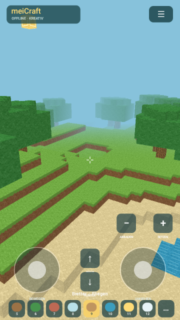

# meiCraft

Ein eigenständiges, vollständig offline spielbares 3D-Klötzchenspiel für Android. Native Java-App mit OpenGL ES 2.0, eigener Weltgenerierung und selbst erzeugten Texturen. Keine Konten, Werbung oder Käufe. Zum Spielen sind weder Server noch Internet nötig.

**[APK herunterladen](https://github.com/pehab/MeiCraft/releases/latest)** · Android 8.0 oder neuer · Hoch- und Querformat · Version 0.1.1



## Erste spielbare Version

- Eine generierte Welt mit 96 × 96 × 48 Blöcken, Hügeln, Sandufern, Wasser und Bäumen.
- Kreativmodus: zwölf unbegrenzt verfügbare Materialien, Blöcke abbauen und platzieren.
- Touch-Joystick, freie Kamerasteuerung, Fliegen oder Laufen mit Kollisionen und Springen.
- Zielmarkierung am anvisierten Block, Reichweite sechs Blöcke.
- Lokaler Spielstand: Welt, Bauwerke, Kameraposition, Material und Bewegungsmodus bleiben erhalten.
- Automatisches Speichern alle 30 Sekunden und beim Wechsel in den Hintergrund; zusätzlich manuell im Menü.
- Neue Welten über einen Namen oder numerischen Seed. Das Ersetzen der aktuellen Welt erfordert eine Bestätigung.

Dies ist eine erste Kreativ-Sandbox. Crafting, Tiere, Gegner, Überleben, Mehrspieler, mehrere Speicherplätze und unendliche Welten sind noch nicht enthalten. Updates werden einmal täglich geprüft und können zusätzlich unter **☰ → Updates** manuell gesucht werden. Die automatische Prüfung ist dort abschaltbar. Nur die Update-Funktion verwendet das Internet. Downloads erfolgen erst nach Bestätigung; vor der Android-Installation prüft die App Größe, SHA-256, Paketname, Version und Signatur. Ein Update mit gleicher Signatur erhält den privaten App-Spielstand. Eine Deinstallation entfernt ihn.

## Steuerung

Links am Kreis bewegen, am rechten Joystick horizontal und vertikal umsehen. Mit **−** den anvisierten Block entfernen, mit **+** das ausgewählte Material daneben setzen. Im Flugmodus mit **↑ / ↓** auf- und absteigen. Im Laufmodus mit **↑** springen. Baumaterial unten oder unter **☰ → Baumaterial wählen** auswählen. Die Weltgrenze ist fest; Wasser lässt sich durchqueren.

## Bauen und testen

Voraussetzungen: JDK 17, Android SDK Platform 36 und Build Tools 35.0.0. Keine Laufzeitbibliotheken oder externen Spiel-Assets.

```sh
export ANDROID_SDK_ROOT=/pfad/zum/android-sdk
./test.sh
./build-local.sh
bash scripts/build-upgrade-fixture.sh
./test-android-build.sh
```

`build-local.sh` baut ohne Gradle-Downloads direkt mit dem Android SDK. Die APK liegt unter `build/meiCraft-0.1.1.apk`. Beim ersten lokalen Build wird ein privater Schlüssel unter `.signing/` erstellt und für weitere Builds wiederverwendet. Dieser Ordner wird niemals ins Repository eingecheckt. Für Updates einer bereits installierten Release-APK muss der ursprünglich verwendete Schlüssel wiederhergestellt werden.

Alternativ Android Studio öffnen oder `./gradlew assembleDebug lintDebug` ausführen. Der Gradle Wrapper ist auf 8.14.6 mit Prüfsumme fixiert. Wenn `.signing/` vorhanden ist, verwendet auch Gradle diesen Schlüssel.

Lint und Java-Kompilierung behandeln Warnungen als Fehler. CI prüft Android 11 und Android 16 sowie beide Ausrichtungen.

### Android-Smoke-Test

App und Test-APK auf einem Emulator oder Testgerät installieren:

```sh
bash scripts/smoke-android.sh
```

Der Smoke-Test verändert seine Testwelt und prüft OpenGL, Touch-Steuerung, Bewegung, Abbauen/Setzen und den tatsächlichen Speichervorgang. Eine zusätzliche Aktualisierung der ursprünglichen 0.1.0-APK auf die aktuelle Version prüft den Spielstanderhalt sowie APK-Prüfsumme, Paketidentität, Signatur und die nur lesbare Installations-URI. Die ursprüngliche APK wird für CI mit dem jeweiligen Testschlüssel neu signiert. Er gehört auf ein Testgerät ohne wertvollen Spielstand. `tests/UpdateTests.java` prüft Update-Metadaten und manipulierte Dateien. `tests/WorldTests.java` prüft zusätzlich deterministische Landschaften, sichere Startpositionen, Raycasting, Kollisionen und ungültige Spielstände.

### Release-Signierung

Die signierten APKs liegen unter `dist/`, inklusive SHA-256-Prüfsumme. Der Workflow testet den Quellcode und veröffentlicht die geprüfte Version samt `meiCraft-update.json`. Die App fragt diesen Manifest-Anhang des neuesten Releases ab; die APK-Adresse verweist immer auf eine konkrete Version. Für spätere Versionen wird das private Repository-Secret `MEICRAFT_SIGNING_JSON` benötigt:

```json
{"keystore":"BASE64_PKCS12","password":"PRIVATE_PASSWORD","alias":"meicraft"}
```

`scripts/restore-signing.py` stellt daraus `.signing/` wieder her. Der private Schlüssel und das Passwort gehören nicht ins öffentliche Repository. Die gesicherte Signierungsdatei gehört dem Projektinhaber. CI-Builds ohne dieses Secret erstellen nur einen temporären Testschlüssel; solche Builds ersetzen niemals die veröffentlichte APK. Versionsnummern stehen zentral in `version.properties`.

## Aufbau

`World.java` enthält Terrain, Kollisionsprüfung, Raycasting und das versionierte GZIP-Speicherformat. `VoxelRenderer.java` erzeugt sichtbare Blockflächen in 16 × 16 großen Chunks und zeichnet sie mit Texturen, Richtungslicht und Nebel. `GameView.java` verwaltet Touch-Steuerung, Bewegung und HUD. `MainActivity.java` übernimmt Menüs, Lebenszyklus und atomare Speicherdateien. Speicherjobs laufen seriell; beschädigte Dateien werden vor dem Überschreiben als lokale Sicherung abgelegt.

`app/src/main/assets/blocks.png` enthält ausschließlich prozedural erzeugte Originaltexturen. Zum Neuerzeugen: `python3 scripts/generate-textures.py` (Pillow erforderlich). Keine Minecraft-Dateien oder Original-Assets. Das Projekt ist unabhängig von Mojang und Microsoft.
